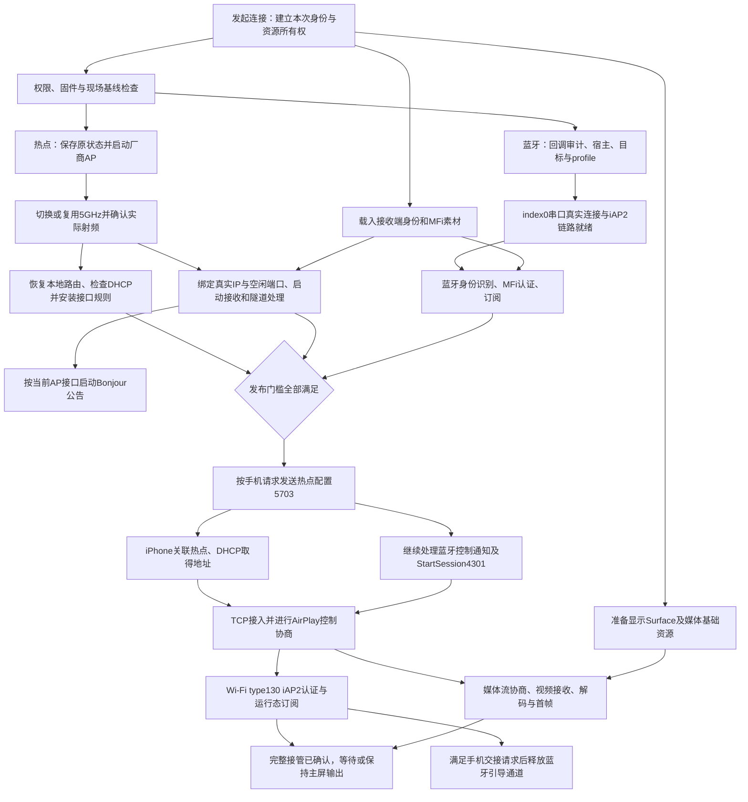

# 2026年10月26日 07:23｜先锋车机蓝牙接入无线CarPlay技术路线与验证报告

更新：2026-10-26 13:08（北京时间，Asia/Shanghai）。分支 `feat/pioneer-wireless-carplay`，基线 `beta/0.2.0` / `55678ec1`。
本文件合并此前两份 2026-10-25 分析报告，并以新的固件核查和探针实现修正旧结论。2026-10-14 的实车记录作为历史证据保留，不改变其当时的测试结果。

## 2026-10-26 实车结论（以此节为准）

**已在实车打通：先锋内置蓝牙 → iPhone接受热点参数及CarPlay StartSession → 车机自身5GHz热点 → iPhone TCP接入 → type130 iAP2 tunnel → Wi-Fi侧MFi AA05认证。无需外接蓝牙或Wi-Fi模块。仍未进行画面、声音和长期稳定性验收。**

### 蓝牙根因与实际修复

实车服务启动后只有7个回调对象，确实缺少 `CBlueforcePower+0x58` 串口回调。通过复用 DiPlay root 调度，在原服务进程里调用原注册函数，回调数变为8，原服务 PID303 未变化。随后同UID宿主取得真实串口原始收发，无需另装蓝牙模块或移植驱动。

另修正原生审计工具的装载偏移：本机 `libbluep.so` 首个 PT_LOAD 的 p_vaddr=0x2000，因此运行地址为 maps 首映射起点减0x2000再加符号虚拟地址；不能直接使用首映射起点。修复前工具因锚点不符安全停止，未执行错误地址。

实车蓝牙协议证据：

| 阶段 | 时间（北京时间） | 结果 |
| --- | --- | --- |
| 内部回调7→8 | 06:55:00→06:55:33 | 原对象、原注册函数，服务没有重启 |
| 真实 index0 / Apple UUID / 目标手机 | 06:56:16 | native connected=true，地址与UUID相符 |
| 蓝牙 iAP2 / Identification / MFi AA05 | 06:56:18 | 认证与订阅完成 |
| Wi-Fi配置、transport通知后配置、CarPlay StartSession | 06:56:18→06:56:19 | 配置发送2次，StartSession发送1次 |
| iPhone TCP进入真实AirPlay接收端、type130 SETUP | 06:56:20→06:56:22 | 不是仅发现Bonjour或受理连接请求 |
| Wi-Fi iAP2 tunnel AA05 | 06:56:23 | 手机真实接管并认证 |
| 最终判据 | 06:57:47 | bluetoothControlComplete=true、wifiRuntimeAuthenticated=true、bluetoothWorkVerified=true |
| 清理 | 06:57:49 | 释放端口、注销宿主监听，profile130恢复2 |

原生接收1045字节；24次TX完成结果均为0，无队列溢出。90秒控制窗口正常结束，不是协议等待卡死。接收端目前不渲染画面、不输出音频，不能把上述结果叫作影音验收通过。

### 车机自身发射5GHz热点

用户要求的是车机作为AP。此前连接 Xiao 的5785MHz结果只能证明STA和同网段交接，不能替代AP验证。

固件 `wifi-service.odex` 实际逻辑：`SoftApManager` → `WifiNative.createInterface` → `DRIVER interface_create bcm1` → `INTERFACE_ADD`，热点配置通过已有 `wpa_supplicant` 完成。`WifiNative.setFreq` 写死 `SET_NETWORK 0 frequency 2`，标准 `apBand` 值未直接传给该命令。因此采用厂商热点启动，再在专用AP接口上更改频段的路线。

实车已取得：

- root `startTethering` 使AP状态11→12→13；`bcm1` 得到192.168.43.1/24，dnsmasq运行，TetheredState lastError=0。
- 初始内核 nl80211：iftype=3（AP）、2412MHz，证实原来是2.4GHz。
- 运行中只发 `SET_NETWORK ... frequency 5` 和 `SELECT_NETWORK`，返回OK但仍为2.4GHz；必须先停用网络，再重新启用/选择，使配置真正生效。
- 07:18:11，supplicant STATUS：mode=AP、wpa_state=COMPLETED、freq=5805、WPA2-PSK/CCMP。
- 独立只读 nl80211 查询：bcm1、iftype=AP、实际5785MHz、中心频率5775MHz、80MHz带宽枚举。07:20:31至07:20:57连续6次保持一致。
- supplicant配置频率5805与内核实际5785不一致，报告精确信道时采用内核结果（157），不能用5703中硬编码信道掩盖差异。两层都确认5GHz，但尚未用独立接收设备扫描信标核对发射信道。
- 固件 CARNET 过滤链原先只覆盖wlan0等接口，没有覆盖bcm1；已为专用接口添加可清理规则，随后结合本地路由修复验证DHCP和真实CarPlay连接，详见后续实车节。

新增热点诊断复用主目录已有实现，并修正Android7不支持的Process等待API、supplicant数据报边界、DEX文件覆写和首次加载等待问题。新增内核只读工具源文件 `bluetooth-probe/tools/wifi_nl_audit.c`。

原始取证保存在忽略目录 `agent_docs/temporary/2026-10-26-实车验证/`，包括03蓝牙最终结果、04/06热点协议状态与05内核状态；不将私密凭据或认证材料加入版本控制。

### 车机热点上的接收端端口

07:25首次AP交接在准备阶段因BindException停止；/proc/net/tcp6证实8721监听属于UID10066（高德导航），尚未进行本轮蓝牙协议交换。保留现有导航进程，专用AP模式改用空闲监听端口并通过iAP2/Bonjour发布真实端口，动态媒体端口由bcm1专用通行规则覆盖。Xiao等既有LAN路径继续使用原固定转发端口，避免把AP通行条件误用于其他网络。

### DHCP的真实阻塞与修复

第一轮AP协议测试蓝牙控制全部完成，但Wi-Fi没有进入接收端；不能与此前Xiao成功混为一轮。内核可查到关联终端，而仅报文头取证显示终端持续发DHCP请求，车机没有回复，终端使用169.254.217.72。CARNET专用接口规则已有命中，UDP校验错误为0，进一步查到Android本地路由缺失。

netd日志证实07:08曾成功添加 `network route add local bcm1 192.168.43.0/24`。切换频段时AP经历down/up，此路由从 `local_network` 表消失，IPv4连接网段仍留在main表。Android策略路由先命中USB默认网络，普通 `ip route get 192.168.43.92` 因而错误走usb0。07:37定向重新添加原netd路由后，查询立即改走bcm1；报文头可见DHCP回复，终端从169.254地址切换为192.168.43.92。没有重启蓝牙服务、换驱动、重置整套防火墙或重启dnsmasq。

诊断程序已将这条恢复逻辑纳入5GHz切换及专用接口放行动作：根据bcm1现有IPv4前缀核对local_network，缺失时使用原netd命令添加，再回读确认。只改frequency并重选网络不足以使已运行AP换频，因此需停用/重启AP网络；停用回复超时时重开控制socket并验证DISCONNECTED后才继续。界面新增热点启动、5GHz、状态、接口通行、停止清理和自身热点完整交接入口。

### 车机5GHz热点上的真实协议交接

| 实车时间 | 证据 |
| --- | --- |
| 07:38:01 | 接收端绑定192.168.43.1:46801，通过iAP2/Bonjour发布真实端口；热点信道按未知0处理，没有使用错误的标准AP配置强行报告2.4GHz |
| 07:38:15 | 蓝牙身份识别、MFi AA05及订阅全部完成 |
| 07:38:16 | 4301 CarPlayStartSession发送 |
| 07:38:17 | iPhone从192.168.43.92实际TCP接入 |
| 07:38:18→19 | AirPlay会话激活及type130 iAP2 SETUP |
| 07:38:21 | Wi-Fi tunnel身份识别及手机MFi AA05认证完成 |
| 07:39:42 | bluetoothControlComplete=true、wifiRuntimeAuthenticated=true、bluetoothWorkVerified=true；原生RX982字节，21次TX完成均为0，无队列溢出 |
| 07:39:46→48 | profile恢复2，串口宿主/两侧iAP2会话均关闭，本轮正常结束 |

同期独立内核查询仍为bcm1/AP/5785MHz/80MHz，并记录同一关联MAC。由接收端TCP对端与协议应答确认，DHCP恢复后的终端确为本轮iPhone。原始证据为11（路由修复后的DHCP报文头）和12（自身热点完整交接日志）。报文头工具只记录IP/端口/长度/标志，没有保存媒体或认证载荷。

### 可行技术路线与剩余边界

1. 复用DiPlay已有root调度，修复匹配固件中的服务串口回调漏注册；同UID宿主承载真实Blueforce串口收发。
2. 复用DiPlay既有iAP2/MFi控制逻辑；蓝牙阶段告知iPhone车机自身热点配置及真实AirPlay接收端。
3. 启动厂商SoftAP/bcm1，切到5GHz后恢复Android本地网络路由，为专用AP接口添加带标记、可清理的通行规则。
4. iPhone通过车机5GHz热点完成AirPlay/type130及Wi-Fi MFi认证。本次已真实完成该链路。

还需实际影音渲染、触控、声音路由、长时间稳定性、首次配对/自动重连、重启后自动恢复，以及用独立接收设备进一步核实精确信道。当前没有证据要求移植蓝牙驱动或外接模块；这些不是本路线的前置条件。

### 当前可安装版本与验证范围

- APK：`bluetooth-probe/build/outputs/apk/debug/bluetooth-probe-debug.apk`，versionCode15，targetSdk23，使用主项目 `.signing` 的既有证书签名，并以 `adb install -r -d` 覆盖安装。
- 最新APK SHA-256：`c1ea0e7c994adf1f07f0b44ae861c204da64b9cc897c2f5713f2027aa4d77f27`。
- 本轮采用本机缓存的javac/Kotlin编译、D8/L8、资源复用和签名打包，不声称做过干净Gradle全量构建；签名校验、ZIP重复项检查及实际覆盖安装均通过。
- 蓝牙及车机自身5GHz热点上的认证交接已实测；最终版本另包含已核实netd命令的自动路由恢复。热点保持开启供后续继续，诊断协议会话及临时报文头任务已结束；保留原车导航进程。
- 最终覆盖版本再次执行5GHz动作，读回AP/5GHz及正确local_network路由，RESULT: OK；没有遗留root助手、串口宿主或报文头进程。Mac本轮caffeinate已停止。
- 现有日志清空按钮继续保留。工作树为 `DiPlay-wireless`，未提交或推送本轮修改。

## 桌面“无线CarPlay.apk”静态对比（2026-10-26）

已分析用户指定APK，未安装或运行。SHA-256为 `174f306cbb549d79baadaeba6d770464a5b6997911d9650c27d25f550353d515`，包名 `com.gtmc.app.fengyunyx.b819`，版本 `1.4.70-camry-local-preview-licensed`，入口 `CamryHomeActivity`，ARM32，最低API25。代码结构为DiPlay/XcertPlay体系的凯美瑞适配版；不能仅由APK确定原始Git分支或作者。

**同样实现“蓝牙引导→车机5GHz热点→iAP2/MFi/AirPlay”，但默认蓝牙后端与本报告实测路线不同。** `CarPlayHostActivity` 的无线先锋分支实际注入 `CamryNativeBluetoothProvider`、`CamryNativeHotspotProvider`、`CamryNativeWirelessNetworkProvider`。包内虽也有先锋SPP桥接资源，但不能把其存在当作当前默认入口使用它的证据。

| 对比点 | 桌面APK | 本分支已验证路线 |
| --- | --- | --- |
| 蓝牙硬件 | 原车同一颗模块，独立Bluedroid类用户态栈，经/dev/ttymxc1、3000000波特率、RTSCTS接管 | 原车模块、原厂Blueforce栈及SDK原生串口接口 |
| 原厂服务 | supervisor核实原服务基线，停用后等待UART释放，结束时恢复服务及UART归属 | 原服务内补注册缺失回调；本轮PID保持不变，不另建硬件栈 |
| 电话/音乐与配对 | 自带设置文案明确提示原厂蓝牙电话、音乐暂停，重新配对可能影响手机旧记录；独立bt_config持久化 | 已复用原配对；临时profile保存恢复，仍须验收电话/音乐并发，不能声称完全无影响 |
| 固件依赖 | 依赖目标UART、芯片/HAL、原厂启停及恢复约定 | 依赖已核对的服务二进制地址/布局/哈希，版本变化需重核 |
| 热点 | 同为厂商SoftAP/bcm1/supplicant；native频率工具、实际射频校验、租约式恢复，可接收指定MHz | 已验证5GHz；补回切频丢失的local_network路由，恢复系统DHCP |
| IP网络 | 自己管理专用dnsmasq地址池，最多4个租约；不下发默认网关/DNS，另有IPv6链路本地通路及限定规则 | 复用Android系统tethering/DHCP，IPv4 192.168.43.0/24已真实交接；当前接口放行规则较宽 |
| 工程完整度 | 已有正式控制器/影音接收、开机预热、驻留复用、进程监管、状态日志及恢复机制，另有设备授权检查 | 当前为诊断程序和经实车验证的接入逻辑，需要接入DiPlay正式运行与影音流程 |
| 实测证明 | 本次只静态分析，不能据代码、版本名或状态标签推断已在本车跑通或更快 | 07:39完整交接认证成功有实车日志；影音和长期稳定性仍未验收 |

固件能力识别使用与本车相同的平台指纹，标记的已审计产品版本为 `1.000062_1`；我们本轮现场产品版本为 `1.000152_1`。该布尔标记没有直接关闭先锋平台的无线入口，故不能误报为“新版本不能运行”，但也不能据包名推断当前版本已经兼容实测。

APK设置文案明确提示：启用定制蓝牙会暂停原厂蓝牙电话和音乐；恢复先锋会断开当前无线CarPlay；重新配对可能更新手机保存的车机记录，恢复先锋后可能需要重新配对。该影响由程序自身明确告知，不仅是推测。

判断：优先保留本分支已跑通的先锋蓝牙入口，减少整体接管原车蓝牙的必要性；可借鉴桌面APK的热点预热、驻留复用、精确射频校验、受限网络规则和异常恢复。独立协议栈对扫描/配对/RFCOMM更可控，也减少对原厂内部回调布局的依赖，但增加UART独占、配对状态和服务恢复的工程责任。不能不做同车对照就断言哪套更快、更稳定；两者应按原车功能共存、固件版本、建连速度和恢复成功率分别比较。

静态材料在忽略目录 `agent_docs/temporary/2026-10-26-无线CarPlay包分析/`，包含主APK和内嵌Wi-Fi会话JAR反编译、关键二进制及分析索引。JADX部分方法初次反编译失败，对连接入口重新使用show-bad-code还原；这类反编译占位异常不是APK真实逻辑中的抛错。

## 无线连接建立的节点时序与并行设计

设计时间：2026-10-26 13:08（北京时间）。本节是拟集成到DiPlay的连接编排设计，未修改连接代码。采用已实测的“先锋Blueforce串口＋车机自身5GHz AP＋系统DHCP”路线，不改成桌面APK的独立蓝牙栈或独立DHCP。主路径以iPhone已有原车蓝牙配对为前提；首次发现、配对和自动重连需单独验收。

### 与有线连接方案一致的口径

沿用有线连接“阶段概览＋独立任务状态＋单调时钟耗时”的结构，以真实事件推进，不解析展示文案、不使用固定延时冒充完成。当前代码 `ConnectionTasks.kt` 已明确允许任务重叠；阶段耗时与任务耗时必须分开。

- “连接请求发起”：应用接受本次连接请求并创建attempt/generation。开机预热另行计时，复用资源记录REUSED，不伪装成本次从零创建。
- “控制交接完成”：当前iPhone的Wi-Fi type130通道身份识别、MFi AA05和必要订阅完成；不是TCP accept、AirPlay RECORD或StartSession发送完成。
- “主屏可见”：当前主屏type110的首个解码帧已经释放到Surface。与有线现有首帧统计一致，不宣称这是物理屏幕实际呈现时刻。
- “音频就绪”与“交互通道就绪”：独立记录。不能因为手机没有播放声音或用户没有触摸，就把整个连接一直判为未完成；但首帧也不能代替影音/触控验收。
- 当前探针只证明“控制交接完成”，不渲染影音。探针末尾90秒/120秒窗口用于观察和清理，不能沿用为正式会话生命周期，也不计为实际建连耗时。

### 总体依赖图

图中的边表示必须满足的前置事实，不表示仅能由一个线程串行执行。流程管理、原厂蓝牙、热点、接收端和媒体是职责划分，并非本次已新增的类。



补充：iPhone可通过Bonjour或保留的会话身份提早连接，TCP监听必须提前运行；图中D1/C2→T描述本轮主动引导路径的正常条件，不能据此拒绝已通过身份验证的早到连接。type130认证与媒体请求要由各自处理器服务，不能把两者在RTSP读线程里互相等待。

### 节点职责、完成证据与执行顺序

| 节点 | 谁负责、做什么 | 前置条件 | 完成证据与下游 |
| --- | --- | --- | --- |
| N0 本次连接登记 | 连接协调器分配attempt/generation、目标iPhone、取消令牌、整体期限和资源所有权；登记已有会话和未恢复记录 | 用户连接请求或已启用的自动连接策略 | 本轮身份固定、无其他会话争用；随后R/L/V0并行 |
| R 权限与固件基线 | 复用DiPlay root调度；检查当前boot、车机/ABI/关键二进制匹配、服务身份；识别需恢复的上次现场 | N0 | 允许本次受控操作，未知固件或未恢复占用停止；B1/A1可启动 |
| L 本地身份与认证准备 | 载入持久化AirPlay身份、配对存储、MFi证书/密钥并检查匹配；读取期望热点配置 | N0 | 本地素材可用，不代表手机已认证；提供B3和E1 |
| V0 显示与媒体预备 | 在UI线程准备Surface生命周期，后台查询解码能力、建立接收缓冲和调度；音频只做能力准备 | N0 | Surface/资源引用绑定本轮；实际codec配置仍等手机的格式数据，预热不抢原车音源 |
| B1 先锋蓝牙准备 | 审计并按需补注册原服务串口回调；建立同UID宿主；核对配对目标、全部串口占用、原profile并先持久化恢复信息 | R | 回调存在、目标明确、配置允许Apple串口；profile/串口操作由单一所有者串行执行 |
| B2 串口与iAP2就绪 | 明确请求index0，确认目标MAC、Apple UUID、底层连接标志，再建立iAP2链路 | B1 | 底层连接证据＋iAP2 READY；返回0或134缓存单独变化均不算完成 |
| B3 蓝牙认证 | 按现有协议顺序执行身份识别→MFi AA05→必要订阅 | B2＋L | 当前手机认证及订阅完成；它可等候发布门槛，但iAP2收包/保活不能停 |
| A1 厂商热点启动 | 保存原Wi-Fi/AP状态、配置和归属，启动厂商SoftAP；已有可用AP则进入校验，不无条件重启 | R | AP启用、bcm1可识别、地址可读；AP状态13尚不证明5GHz或DHCP可用 |
| A2 5GHz射频确认 | 按厂商路径切换频段或复用已有5GHz，处理AP停用/重启；重新核对接口index/MAC/IP、实际频率 | A1 | 同一AP租约下内核iftype=AP且为5GHz；不能用apBand、SET_NETWORK返回OK或wlan0频率代替 |
| A3 AP本地网络准备 | 对本次AP恢复local_network连接网段路由，核对系统DHCP服务和专用接口通行规则；记录所有变更 | A2 | 路由确实经bcm1，服务/规则齐备；这是“服务准备好”，真实DHCP回复在D1验收 |
| E1 接收端准备 | 在稳定的AP地址绑定空闲端口，启动accept循环，安装type130隧道处理器；发布与该监听器一致的身份和端口 | A2＋L | socket已绑定、接收和隧道回调已可用；A3可与E1并行，端口不固定抢占原车导航的8721 |
| E2 Bonjour | 绑定当前AP接口/地址启动公告，并记录公告状态 | E1 | 公告启用；直接IP/端口已通过iAP2提供时，不把“尚未收到发现回调”误当socket未就绪；明确依赖发现的模式另行设门槛 |
| G 发布门槛 | 协调器汇合B3、A3、E1，核对本轮AP快照、真实端口、身份和取消状态 | B3＋A3＋E1 | 认证、AP、路由/DHCP、规则、监听均属于本轮；允许发送手机可使用的配置 |
| C1 发送热点参数 | 在已认证的蓝牙控制通道响应5702，发送5703热点配置；遵守重发上限 | G＋手机对应请求/通知 | TX只证明已发送；随后D1可启动，不等蓝牙控制循环结束 |
| C2 后续蓝牙控制 | 按收到的事件处理4e0d可用状态、4e0e transport标识及后续5703；收到4300后复核端点，再发送4301 StartSession | G，保持同一控制通道 | 逐项记录发送和接收证据；通知与Wi-Fi请求按事件处理，不强制所有手机采用同一日志顺序 |
| D1 手机入网 | 车机服务侧观察关联、DHCP请求/回复和新租约；不把静态ARP或关联MAC直接当作目标iPhone身份 | 收到可用的5703后可开始 | 当前终端取得有效地址；169.254自分配地址不是本轮IPv4入网成功；后续用TCP/认证关联目标 |
| T AirPlay控制接入 | 接收iPhone TCP，建立本轮AirPlay身份/安全和控制协商，响应事件、SETUP等请求 | 接收端已运行；正常主动路径需手机入网和获得StartSession端点 | 真实控制收发，不把TCP accept或RECORD当最终建连成功 |
| I Wi-Fi运行态控制 | type130 SETUP后在独立任务处理iAP2 READY→身份识别→MFi AA05→订阅，挂接运行态元数据和车辆信息 | T收到type130隧道 | 当前generation的认证控制通道可用，记录CONTROL_HANDOFF_READY |
| M1 媒体协商与接收 | 按手机请求建立屏幕、时钟、音频和控制资源；视频数据有界入队，按SETUP关系绑定流 | T＋对应媒体请求 | 第一份有效视频数据到达和各流就绪分别记录，不等待主线程或音频实际发声 |
| M2 主屏首帧 | 得到codec参数后配置解码器，将主屏首帧输出到当前有效Surface | M1＋V0＋有效视频格式/帧 | type110首帧输出事件，记录DISPLAY_READY；副屏首帧不能提前完成主屏统计 |
| M3 音频与交互 | 音频格式确定后建立轨道并按既有车机音源策略申请资源；触控/方控绑定当前会话 | 相应媒体/控制协商，必要时依赖当前显示几何 | 分别记录能力/通道就绪和实际使用验证；无需等待用户播放音乐或实际触摸 |
| H 引导通道交接 | 复用现有交接策略，在手机交接请求＋Wi-Fi运行态认证就绪时，由唯一所有者释放本次蓝牙引导资源 | I＋当前generation的手机交接请求 | 关闭本次SPP/宿主监听而不停止原厂蓝牙服务；可与媒体启动并行，不是首帧的强制前置 |

### 哪些任务可以并行

| 并行组 | 可同时做的任务 | 汇合点与约束 |
| --- | --- | --- |
| P1 本地准备 | R权限/固件、L身份/MFi素材、V0显示能力/缓冲准备 | 各自产出本轮状态；不并发改全局音源、配对或同一份持久化身份 |
| P2 蓝牙与Wi-Fi | B1→B2→B3 与 A1→A2→A3/E1 | G等待全部必要前置，逻辑上允许BT先认证；硬件/API资源仍各自串行 |
| P3 AP稳定后的准备 | A3路由/DHCP/规则 与 E1监听器绑定/接管回调 | 绑定监听不需要先完成规则安装，但向手机发布可用端点必须等两者完成 |
| P4 手机入网与蓝牙尾部 | D1关联/DHCP 与 C2通知、重发和StartSession | 手机收到热点配置即可开始入网，不等待整个蓝牙循环返回；TCP按有效会话接收 |
| P5 Wi-Fi接管与媒体 | I隧道控制认证 与 M1媒体协商/接收；视频和音频按各自格式处理 | 不把协议接收线程堵在另一个分支的完成条件上；记录交接完成、首帧、音频为不同事实 |
| P6 热启动复用 | 已验证的AP/本地网络、root助手和本地素材可分别校验并复用 | 校验当前boot、接口身份、地址、频率、端口归属和有效期；快照不是永久有效凭证 |

任务允许并行不代表无限增加线程。权限检查、证书加载、热点和蓝牙启动都可能争用这台车机的CPU；优先复用已就绪资源，限制并行工作队列，协议收发不做磁盘、全量诊断或重型DEX编译。

### 哪些顺序不能打乱

1. 同一先锋蓝牙服务的回调修复、profile修改、端口释放/启动保持顺序，profile原值必须先落盘再修改。当前临时配置实验只允许单配对设备，正式支持多设备前不能删掉该保护。
2. 同一AP的启动、停用、切频、实际射频确认串行。切频后的接口快照、本地路由和规则必须重新校验，不能复用切频前的“网络就绪”。
3. 同一iAP2通道的身份识别→认证→订阅保持现有实现顺序；一个通道只有一个接收所有者，其他业务通过分发器获取事件。不能让两个协程分别recv抢同一份数据。
4. 对手机发送热点配置或StartSession前必须满足G。iPhone早发5702时记录待处理请求、在协议期限内等待端点就绪，同时继续收包/保活；不能发布虚假IP/端口或永久阻塞唯一接收线程。
5. 5702/5703、4e0d、4e0e、4300/4301属于事件驱动控制，不预设“所有transport通知必定先于4301”。收到需要重发的通知时，重新核对当前端点并执行有界重发。
6. 不能StartSession一发完就关蓝牙；正式运行不得在90秒诊断窗口结束时主动关闭成功会话。保留现有“手机要求交接＋隧道已认证”条件，以及已有的投屏可用但隧道未就绪时保留蓝牙控制的回退；回退不能标记为完整Wi-Fi控制交接成功。
7. 媒体解码配置必须等实际格式参数，音频轨道必须等实际音频格式；可以提前创建Surface、查询能力和缓冲，不能用预热完成代替收到媒体。

### 当前代码实际顺序与需要拆开的边界

当前实车探针 `PioneerCarPlayProbe.prepare` 先载入素材、附着现有热点、创建监听和隧道回调；完成后 `PioneerSerialProbe.run` 才执行蓝牙基线、临时profile、串口、iAP2及控制认证。热点启动/切频/网络修复目前还是独立诊断动作。**本节的B/A并行编排尚未实现。**

`Iap2WirelessControlClient.run` 目前入口必须取得完整endpoint，并在内部顺序执行身份识别、MFi和订阅，随后进入热点/StartSession消息循环。若要让B3真正与热点冷启动重叠，需要拆开“认证准备”和“取得已就绪端点后响应控制消息”的边界，或引入支持待处理请求和截止时间的端点供应机制；仅把整个run放到另一线程并不能解除endpoint前置依赖。蓝牙鉴别信息中需要的名称/地址应先从稳定配置取得，发布前再核对AP最终配置。

现有正式 `CarPlayController` 已有type130专用执行器、generation检查、交接看门狗、首帧证明及蓝牙保留回退，应复用这些行为。正式集成的职责边界如下：

| 现有代码 | 计划职责 |
| --- | --- |
| bluetooth-probe/PioneerCallbackRepair、PioneerSerialProbe、PioneerBlueforceHost | 提取已验证的原厂蓝牙传输能力，保留固件匹配、占用保护和配置恢复；诊断专用等待/90秒结束逻辑不带入正式会话 |
| bluetooth-probe/HotspotProbeHelper、RootCommand | 提取AP及本地网络租约：创建/复用、切频、路由、系统DHCP、规则、清理 |
| shared/transport/Iap2WirelessControlClient | 明确蓝牙认证与端点发布的同步边界，保持协议消息和单接收所有者 |
| shared/orchestration/CarPlayController | 唯一连接协调器，组合任务、合流、取消、身份核对和交接；不再另建一套互相竞争的正式控制器 |
| shared/airplay/AirPlaySession、CarPlayMediaEngine 与 media/AndroidMediaSink | 复用AirPlay控制、type130、媒体收发及主屏首帧；把诊断的禁用影音配置替换为正式能力 |
| orchestration/progress/ConnectionTasks、ConnectionProgressEvents、common/connection/ConnectionProgressPanel | 沿用有线的独立任务快照；新增无线细节点和类型化事件映射，不由中文日志推进 |

当前任务过滤器只为VPN显示ROOT/RULES/NETWORK_READY，为有线显示SESSION_AUTH；本先锋无线路线实际同样涉及root、AP路由/规则和Wi-Fi运行态认证，因此不能直接复用旧WIRELESS列表宣称节点已覆盖。应按实际无线后端能力显示这些任务，避免把普通Android无线模式也错误标成必须root。首次蓝牙认证与Wi-Fi运行态认证必须独立标记。

### 失败、取消与资源回收顺序

所有节点使用同一个attempt/generation和取消令牌。失败节点保留原因；依赖它的未启动节点标为SKIPPED，已启动分支收到取消；旧generation回调不更新新尝试。

资源按真实依赖回收：停止对外公告和新接入→关闭本次协议会话/媒体，释放本次蓝牙引导及宿主监听→确认使用者退出→恢复本次临时profile→按租约释放本次网络规则、路由及AP。蓝牙和Wi-Fi分支的独立释放可并行，但AP/网络不能在其接收端仍被使用时先拆掉。超时恢复未确认时保留恢复记录，不直接再开新一轮叠加修改。

- 预先存在、借用的AP不得当作本次创建的热点强制关闭；保留热点仅在用户启用驻留策略时进行，并在下次使用前重校验。
- 正常交接时只释放引导通道；profile是否立即恢复涉及原厂状态机，尚无边运行CarPlay边恢复profile的完整实测。集成初期保留其恢复责任到整个会话结束，不能照搬探针结束后的恢复时机到运行中。
- 服务内部补回的原生回调属于原服务对象，不随应用断开再注销；应用只注销自己的宿主监听。原服务重启后重新审计。
- 开机预热默认可做本地素材、权限和助手准备；会断开现有Wi-Fi的提前建热点、会修改原车连接的profile操作，需由对应已启用的自动连接策略决定，不以“预热”名义无条件执行。

### 计时、瓶颈与本轮实测基线

任务状态沿用PENDING/RUNNING/COMPLETE/REUSED/RETRYING/FAILED/CANCELLED/SKIPPED。每个节点记录依赖满足、开始执行、完成及等待外部事件的单调时间；状态上报必须来自实际执行点。媒体首帧、Wi-Fi认证、DHCP回复等事实到达后分别保留，不能靠任务编号推断别的节点也完成。

整体耗时取“连接请求发起→目标里程碑”的墙钟差，**不能累加并行任务耗时**。第一段关键路径约为蓝牙分支与热点/端点分支中较慢的一支；下一段为手机入网与蓝牙尾部控制中较慢的一支；后面取AirPlay及实际媒体/控制准备的依赖路径。任务依赖等待、用户首次配对等待、重试退避、开机预热和本轮实际执行耗时分开统计。

本轮成功样本热点已事先就绪，不是冷启动AP耗时：

| 相对阶段 | 实车时刻 | 说明 |
| --- | --- | --- |
| 连接验证开始 | 07:38:00.130 | T0 |
| AP上的接收端监听就绪 | 07:38:01.469 | T0+1.339秒 |
| 蓝牙iAP2 READY | 07:38:12.209 | T0+12.079秒，前段包含基线、宿主、临时profile、端口切换及连接，不是单纯RF连接耗时 |
| 蓝牙AA05 | 07:38:14.265 | 身份识别后手机真实认证成功 |
| 蓝牙认证及订阅完成 | 07:38:15.272 | G中的蓝牙条件满足 |
| StartSession已发送 | 07:38:16.981 | 热点配置和控制通知另有逐项日志 |
| iPhone TCP进入 | 07:38:17.122 | 实际对端192.168.43.92 |
| AirPlay RECORD/active | 07:38:18.957 | 仍不等于完整接管 |
| type130 SETUP | 07:38:19.082 | 在AirPlay active之后，证明不能把type130认证强制排在所有AirPlay控制消息之前 |
| Wi-Fi AA05 | 07:38:20.757 | 手机认证成功 |
| Wi-Fi认证及订阅完成 | 07:38:21.949 | T0+21.819秒；控制交接就绪 |
| 主屏首帧、音频和触控 | 未测 | 诊断接收端不渲染影音，不能填写预计成功时刻 |

由本样本可确定：本地AP已就绪时，前段蓝牙准备/串口流程占较大时间；没有数据可以把并行后冷启动总时间承诺为固定秒数。下一次集成验收分别采“全冷启动、热点复用、蓝牙已连接、取消后重试”四类样本，核对节点顺序、汇合条件、恢复及首帧；不先堆大量无关测试。

## 2026-10-25 固件推导及历史现场记录

以下保留前期推导和当时未完成状态；其中“下一轮”“待验证”等表述仅对应历史日期，最新结论以本文件前面的2026-10-26实车节为准。

## 先看结论

**当前优先验证的路线是：审计并按需补注册先锋蓝牙服务内部串口回调，再建立 index0 串口，通过同UID宿主收发原始字节，交给 DiPlay 的 iAP2 引擎。** 不走 Android BluetoothSocket，也不依赖 IOSMgr 把接收数据转发给应用。

固件已证实连接 UUID、目标筛选、原始接收回调、写入和底层 RFCOMM 路径。它足以支持开展软件接入实验，但还不能证明 iPhone 会接受连接，或已经能启动完整无线 CarPlay。

```text
DiPlay root调度 → 服务内部回调审计 / 按需补注册
    → 目标 iPhone 的配对 / 串口配置
    → Blueforce serialportStartConnection(index0)
    → iAP2 UUID / SDP / RFCOMM
    ↔ Blueforce event500 原始 RX / serialportWriteData TX
    ↔ 探针 PioneerBlueforceNative / BlockingDuplexByteStream
    ↔ DiPlay Iap2Session / Iap2WirelessControlClient
    ↔ Iap2IdentificationClient + Iap2MfiAuthenticationClient / LocalMfiAuthenticationClient
    → Wi-Fi配置 / CarPlay StartSession / transport通知及后续配置
    → 真实AirPlay接收端 / type130 iAP2 tunnel
    → Wi-Fi tunnel身份识别及MFi成功：蓝牙工作交接确认
```

同UID原生宿主已在现场成功加载/注册客户端，无需root；但最新固件核查发现服务启动路径遗漏内部串口回调注册，因此0.9.0新增专用root审计/修复。它复用USB/VPN功能所用的特权任务调度机制，不复用其授权结果。以下较早阶段记录保留为历史，当前处理以文末0.9.0补充为准。

## 本轮把哪些固件问题查清了

| 问题 | 静态核查结果 | 新探针的处理 |
| --- | --- | --- |
| 为什么过去的配置3没有连起来？ | index0 枚举要求 Apple 识别且配置与0xf0相交；3没有串口位。未找到目标返回-109，尚未进入底层连接。 | 检查配置、其他候选和 Apple 串口开关；不再把-109当作手机或硬件不支持。 |
| 是否真的用 iAP2 UUID？ | 请求index0读取UUID数组首项，传给真实串口对象，并进入扩展UUID连接、SDP及RFCOMM。 | 显式请求index0；不能复用配置阶段不明UUID的连接。 |
| 接收是不是系统独占？ | 非8端口向已注册客户端广播原始数据；本进程再逐一调用本地监听者。 | 使用独立监听，不替换原车监听者。 |
| 客户端ABI能否还原？ | factory返回本进程静态manager；init、register/unregister及主接口vtable已核对；监听列表仅存裸指针。 | 仅允许已知指纹和精确库hash，ARM32 ABI shim，回调对象存活到进程退出。 |
| IOSMgr77→65→87能否作为字节通道？ | 不能。端口0接收最终只记日志。 | 移除旧主动测试按钮，保留只读状态查询。 |
| connectProfile是否只是保存配置？ | 不是。它进入连接状态机，且会修改其他设备相交的配置位。 | 临时配置仅允许一台配对设备；验证当前SDK位映射，保存原值、回读并尝试恢复。 |
| 原车连接通知是否必然启动第二个iAP引擎？ | 已追踪的 IOSMgr 路径以类型2调用 usbliAPSetConnectType；最终实现对类型2直接返回0。 | 不把这一路通知视为自动启动原车引擎的证据；连接仍无独占租约，运行态要检查其他发送者。 |
| EIR是否是本次主动连接代码的前置门禁？ | 已追踪的主动连接路径按目标地址和UUID执行SDP/RFCOMM，未以本机EIR内容作为该调用的门禁。 | 先验证已配对手机的主动连接；本机发现广告、首次发现和自动重连属于后续产品能力。 |
| SSP/加密能否静态证明已协商成功？ | 能看到安全配置调用，不能从ROM得到某次配对的实际密钥、手机应答和链路安全状态。 | 与实际SDP/连接失败及手机反应一起记录；不把普通配对状态当作安全属性证明。 |

## 新增固件核查细节

### 配置副作用已经落实到代码

`_processConnectProfile @blueforcemanage 0x1bc010` 从Parcel读目标句柄及profile掩码，取设备后调用配置/连接管理器。`CBlueforceProfile::connect @0x19e8e4` 会先进入 `0x19d81c`：遍历其他设备，清除与请求相交的配置位，再更新目标并安排连接。它还涉及现有音频/免提目标状态。因此不能把SDK的 connectProfile 当成一个无副作用 setter，更不能在多台设备上仅保存目标配置后声称可以完整回滚。

探针暂不实现多设备改配置。单设备测试会使用保留原位的 `original | 0x80`，SDK profile编号114实际映射0x80；调用前通过运行时私有 profilePackage 方法逐项验证映射。配置请求产生的 Apple 串口先释放，再明确请求index0。配置恢复也通过 connectProfile，可能重新连接原来的HFP/A2DP。超时、被外部改动或无法确认端口归属时，报告记录需要人工恢复的原值；进程被杀或断电不能保证finally执行。

### 原生客户端注册及生命周期

`libblueforce.so` 的 CBlueforceManage address point=`0x33234`：init(int)位于+8（实现0x1eda8），exit位于+0xc，register/unregister位于+0x10/+0x14；serialportWriteData位于+0x21c，serialportGetDeviceAddress位于+0x230。init(-1)会寻找服务并注册进程客户端，失败有明确返回值。

`CBluenotifyService::add @0x2b4bc` 和对应删除路径使用本地裸指针vector，没有对主监听接口执行RefBase持有或析构。主接口依次为两个析构槽和notify槽，notify参数是event、参数数、原生整型数组。新桥接只实现这个已核对的主接口，回调对象为静态对象，不构造厂商RefBase子对象，不卸载动态库；关闭时注销监听并唤醒接收线程。初始化manager保留到进程结束。

单次RX有效长度1..4096；回调结束前复制到256KiB有界队列。溢出或非法payload使流失败，不能悄悄丢字节后继续称作有效iAP2流。TX按4096字节分块，返回0只表示受理；协议应答才证明手机响应。每次发送前验证端口地址。没有系统级独占锁，地址核对不能替代对并发发送者的运行态观察。

### 连接继续追到了SDP、安全配置和RFCOMM

`app_SppConnectExReq @libbt_stack 0xe4ba8` 调用 `SppcConnectRequest @0x27a49c`。后者在 `0x27a9d4` 调用 `ConnectionSdpServiceSearchAttributeRequest`，在直接RFCOMM分支 `0x27ab4c` 调用 `ConnectionRfcommConnectRequest @0x20f0c4`。该实现 `0x20f32c` 调用 `BTM_SetSecurityLevel`（传入的安全配置字面量0x2030），随后 `0x20f360` 调用 `RFCOMM_CreateConnection` 并设置数据/事件回调。这里不把0x2030直接换算成已协商的SSP模式或加密状态。

### 已追踪的原车iAP连接通知

`IOSMgr::onBTSendCallback @0x3c294` 确实存在写入端口0的回调，不能仅凭RX函数空转就断言原车绝不会发送。连接变化线程 `onSPPConnectStateChange @0x3dc0c` 的调用则已进一步解析：`usbliAPSetConnectType @libiPodiAP1_dio 0x1a188` 是跳板，最终进入 `iPodiUI_SetConnectType @libiPodiUI_dio 0x6678`。`0x66ae` 比较类型2，`0x6708..0x6710` 对类型2返回0；IOSMgr调用恰好传入2。因此这条通知不会启动该实现支持的类型0/1路径。对任意第三方进程或运行时注入不能作全局不存在性证明。

### 应用加载条件

ROM `/etc/public.libraries.txt` 没有libblueforce.so。探针车机版本默认targetSdk23，尝试Android7的旧应用私有库兼容路径；加载结果本身仍须实车确认，失败报告保留linker原文。可用 `-PprobeTargetSdk=37` 构建现代USB测试版本，但它不用于证明车机私有库可加载。车机为ARM32，原生入口还会检查Process.is64Bit、指纹和libblueforce.so SHA-256。APK不携带先锋私有库。

## root能复用什么

现有 `PioneerRootDispatcher` 及 `PioneerRootSessionHelper` 的受控启动、请求文件归属检查、包/UID/APK校验、取消及结果回传可以复用。USB helper做USB授权，VPN helper做VPN权限/防火墙；这些操作都不能直接开放Blueforce字节流。

如果实测普通UID无法加载/注册，应增加独立、持续存活的ARM32 native/ART桥接宿主，以Blueforce客户端身份持有回调，通过有身份校验的本地通道交付字节。不能依赖现有短期初始化root会话一直存在，也不需要先注入Blueforce服务。这是此前0.8.2的实现边界。0.9.0已根据内部回调遗漏的证据加入专用root审计/补注册，原始字节仍由同UID宿主承载；具体限制见文末补充。

## 下次上车必须回答的运行态问题

1. 精确匹配的原生库在探针UID下能否加载、init(-1)、注册和注销？若失败，报告应包含具体加载错误或native返回码。
2. 当前iPhone是否被识别为Apple候选，配置0x80能否生效，index0能否完成对端SDP及RFCOMM建连？目标地址是否准确？
3. event500是否收到手机的真实字节，写入是否得到对端iAP2回复，DiPlay能否达到 `iap2Verified=true`？发生超时要对照手机提示、原车日志及并发发送者，不能只看写入受理码。
4. 停止、超时后端口是否释放，原profile是否恢复，原车通话/蓝牙音频能否恢复？进程异常退出后检查报告中的原配置值。
5. 新版完整测试会继续执行身份识别、MFi、无线配置与StartSession，并观察Wi-Fi tunnel的身份识别和认证。必须由本次手机响应确认，不能用本地签名自检或构建成功代替。画面、音频及触控属于后续产品验收。

这些是手机响应、实际进程权限/状态和物理设备行为，ROM本身无法给出某次测试的成功结果。首轮实验不要求先解决首次发现广告、多设备自动重连和长期共存；它们应在双向iAP2成功后产品化，不与本次可行性判据混合。

## 探针使用与结果判据

见 [bluetooth-probe操作说明](../bluetooth-probe/README.md)。先只读检查，再观察回调，最后按当前配置选择主动验证。历史mask=3适合单设备临时配置测试；程序不会删除其他配对，也不会自动改全局Apple串口开关。

- `open=OK`：本进程初始化和监听注册受理。
- `index0已连接` + 地址匹配：串口连接到所选目标。
- `原始RX`：收到了该端口字节，还不能证明iAP2。
- `iap2Verified=true`：基础按钮的链路就绪结果，仍不是完整蓝牙阶段成功。
- `bluetoothControlComplete=true`：手机身份识别、MFi成功、Wi-Fi配置交付、StartSession、无线可用及transport通知与后续配置均有证据。
- `wifiRuntimeAuthenticated=true`：真实Wi-Fi type130 tunnel完成身份识别与MFi；不是仅看TCP连接。
- `bluetoothWorkVerified=true`：蓝牙控制交付和实际Wi-Fi接管均通过。
- `需要人工恢复profile=...`：自动恢复未被确认，按报告原值从原车界面恢复。

## 固件证据附录

样本：用户提供的 `21款凯美瑞V1.000132版本FOTA升级软件/系统包/NVF-9108ZT/PLATFORM/PJ190PLT.PRG`。512字节PRG头后为Android sparse镜像；解出ext4后只读分析。ROM为1.000132_5，指纹尾部`/5:user/release-keys`；历史实车指纹尾部为`/1:user/release-keys`。精确hash门禁用于避免只凭产品名匹配ABI。

## 1. 谁决定连接哪台设备

旧探针请求 IOSMgr 65。此前已通过重定位确认：

```text
IOSConnectSppReq::exec
    → BTManager 保存的 IBlueforceManage
    → serialportStartConnection(0)
    → Blueforce 服务
    → CBlueforceProfile::sppConnect
```

本轮追清 `sppConnect` 后续：

- `CBlueforceProfile` 的 vtable address point 为 `0x226284`。
- `+0x40` 指向 `0x19ef2c`：选择设备。
- `+0x38` 指向 `0x19eb7c`：sppConnect。
- 选择表 index0=`0xf0`、index1=`0x10`、index2=`0x20`、index3=`0x40`、index4=`0x80`。
- 枚举路径取得每个设备的配置位，再与上述掩码相交。**index0 的枚举路径还要求设备通过 IsAppleDevice 判断。** 缓存路径另外检查缓存状态和掩码。
- `IsAppleDevice @0x1929e8` 具有实际设备识别逻辑，检查 Device ID 信息中的 Apple 厂商值（Bluetooth source 下 0x004c、USB source 下 0x05ac），并有状态回退查询；不是按显示名称包含 iPhone 来猜。
- 目标为空时，sppConnect 返回 -109，尚未调用底层连接。

所以，在只有一台候选 iPhone 时，只配置 HFP/A2DP 的 `mask=3` 不满足 index0 的串口筛选。需要使**目标 iPhone**进入相应的串口配置/缓存选择状态；IOSMgr CLIENT_ID 和应用包名都不能替代这一条件。

历史支持掩码 143=`0x8f`，其中包含 `0x80`。这个事实使 `0x80` 成为有依据的候选配置位，不能再把 `0x10/SPP_APP` 当作唯一选项。原 SDK 的 BluetoothAdapter.profilePackage 将 114 映射为 0x80；BluetoothDevice 的同名常量却是 113，应使用 adapter 的实际映射而非混用常量。

注意：`connectProfile` 同时触发厂商连接状态机，并非纯粹修改一个设置。这里没有把“改成 [107,108,114] 后再发 65”宣称为已经确认无竞态、无副作用的成品操作。正确实现需保存原配置、确认单一目标、观察该入口产生的自动连接行为，并将发起串口的动作限定为正确 index。

## 2. index0 确实进入 iAP2 UUID 连接逻辑

这一步补齐了“固件里看见 UUID 字符串”与“真的拿 UUID 发起连接”的差别。

### 2.1 实际连接函数

`CBlueforceSPP` 构造器 `0x18ef90` 从 GOT `0x22a63c` 取 vtable `0x225b98`，address point 为 `0x225ba0`：

| vtable offset | 实现 |
| --- | --- |
| +0x2c | getSerialPort，0x18fc50 |
| +0x30 | 设备已明确时的连接实现，0x18fd84 |
| +0x14 | writeData，0x18f4d8 |
| +0x20 | getSppIndex，0x18f2a8 |
| +0x24 | setSppConnectInfo，0x18f248 |

`sppConnect @0x19eb7c` 选出设备后，调用此对象的 `+0x30`。不是调用另一个只返回错误的同名/相似入口。

连接实现 `0x18fd84` 会：

1. 校验设备和 index 0..4。
2. 通过 `getSerialPort(index, device)` 取真实串口对象。
3. 检查已连接状态及 Apple 串口开关。
4. 将本次串口对象记录进本服务的端口表。
5. 使用 `UUID数组[请求index]` 调用串口对象的 `startConnection(uuid)`。

`getSerialPort @0x18fc50` 会把 **Apple 设备的物理串口对象选择强制为 0**。注意这是底层对象编号，不等于请求 index 的 UUID 也自动改为 0。请求 index 和物理对象编号必须区分。

### 2.2 UUID 数组与实际调用相接

- 全局 C++ string 数组位于 BSS `0x22b168`。
- 初始化 `0x10a24..0x10a40` 将 `00000000DECAFADEDECADEAFDECACAFE` 写入第一个元素。
- 实际连接 `0x19001a..0x19002c` 计算 `数组基址 + 请求index×12`，并调用串口对象 vtable `+8`。
- `libbluep.so` 的 BTModuleSerialPort vtable（解析动态重定位后为 `0xb8890`，address point +8）确认 `+8` 就是 `BTModuleSerialPort::startConnection(string const&) @0x6e0d4`。

因此，**index0 请求有真实代码路径使用 iAP2 UUID 发起连接**；不能用普通 SPP 0x1101 或任意命名的 profile 连接结果代替。

还要区分：注册 Apple 服务端的 `onRegIapServer @0x189da4` 使用尾部 `...CAFF`；本节主动连接使用尾部 `...CAFE`。此前两者不能混称同一 UUID。

### 2.3 已继续追到蓝牙栈

底层不是让 Android BluetoothSocket 处理：

```text
BTModuleSerialPort::startConnection @libbluep 0x6e0d4
  → BTModuleIF::spp_startConnection @0x8facc
  → BlueTecSPP::bluetec_startConnection @0x72d40
  → BtCmSppExtendUuidConReq @libbt_stack 0x7d544
```

`BlueTecSPP` 会把十六进制 UUID 转成字节，并传给 Extended UUID 连接 API。这个 API 的实现确实复制目标地址和 UUID，建立消息并交给栈处理；不是空实现。栈还包含 128-bit UUID SDP 查询及连接代码。

`libbt_stack.so` 的 `sppCheckUUIDValid @0x278060` 允许 UUID 长度 2、4、16 字节，16-byte iAP2 UUID 没有在这个长度检查处被排除。此处只证明长度格式可接受，不等于所有后续安全与协议条件都已满足。

新增样本：`libbt_stack.so`，3,001,492 字节，SHA-256 `7023a2e579b795e6569bd16363e1d5229d63e5248b611a1490fecef18413ded0`。该库上述函数为 ARM 指令；Blueforce/bluep 相关函数为 Thumb。分析时分别解码，避免把 ARM 解成 Thumb 后误判。

## 3. 蓝牙收到的数据交给谁

### 3.1 Blueforce 具有真实的原始数据回调

接收入口 `ImplBTModuleCallbackSerialPort::onReceivedPacket @0x1ca134` 校验：串口对象、数据指针、长度非零且不大于 4096。随后通过 `getSppIndex` 找该对象对应的逻辑端口。

- 端口 **8** 进入特殊 Parcel 数据分支。
- **其它端口，包括主动连接的端口0**，复制原始数据到共享内存，再发送事件 **500 / 0x1f4**。
- 守住长度和端口边界后，路径保留原始 payload，没有先要求它必须是某个已解析的音乐/通讯录消息。

服务侧 `onReceiveSppData @0x1ba858` 对非8端口遍历已注册 Binder 客户端逐一发送。`libblueforce.so` 客户端侧 `CBluenotifyService::onReceiveSppData @0x2a9b8` 再遍历本进程的监听者，调用：

```text
IBlueforceNotify 回调：event=500, 参数数=3
参数：端口index、原始数据地址、数据长度
```

这不是“只有原厂音乐程序能读到”的排他读取接口。第三方需要实现**厂商 native 回调/Binder 契约**，而不是继续在 Java BluetoothAdapter 中找不存在的 socket 方法。回调内必须复制数据，不能在回调结束后继续使用临时数据地址。

### 3.2 写入也有完整路径

```text
CBlueforceManage::serialportWriteData(index, bytes, length)
  → IMemory / Binder
  → CBlueforceSPP::writeData @0x18f4d8
  → 查本 index 的真实串口对象
  → 检查已连接
  → BTModuleSerialPort::writePacket(bytes, length)
```

客户端封装限定单次长度 1..4096，index0..8。桥接层应分块、有序写入，并依据写入结果/回调处理节流，不能把函数“受理”当作手机已收到。

## 4. 为什么不再推荐旧 IOSMgr 87 路径

`libiosmgr.so` 的 `IOSMgr::onBTEvent @0x3c2b0` 对 event500 检查参数数为3，且端口index为0，然后调用 `IOSMgr::onBTReceiveData @0x3b91c`。

**后者完整函数只有日志调用和返回，没有把字节送给注册客户端，也没有在这里构造 IOSBTReceiveDataCallback。** 旧探针的独立 CLIENT_ID 14 注册成功，不会改变这段函数。

因此在这个 ROM 上：

```text
Blueforce 原始数据 → IOSMgr onBTEvent → onBTReceiveData → 仅日志
```

不能再把“存在 callback 类/事务87”推断为“注册77后一定能从87收到原始字节”。优先直接注册 Blueforce 接收方；这也是本轮对上一份报告的实质修正。

另一个需澄清的边界：广播给多个监听者意味着“收到数据不会天然被其它读者吃掉”，**不意味着串口拥有独占会话权**。系统已有连接状态处理、发送回调和其它客户端仍存在；目前不能据此保证它们绝不会主动写入同一串口。正式接入要明确本次连接所有者和释放行为，不能让两个 iAP2 引擎同时发送。


## 样本校验与复查方式

| 样本 | SHA-256 |
| --- | --- |
| libblueforce.so | 7143ccf70ebb575cbec561bc25964fddc806ed3cbe913e98a04206bf48c6658e |
| blueforcemanage | 61c4b1150b35f61f86f13ab9146fd54f32bf89a61094e2cb13016b939d091541 |
| libbluep.so | 8310b5e3936e33bdc898e948bf71a86373c18c25038209605af7c0d297d6a66c |
| libbt_stack.so | 7023a2e579b795e6569bd16363e1d5229d63e5248b611a1490fecef18413ded0 |
| libiosmgr.so | 0fc8016fd17bb1f86319313e5254c494929372f0a7d93d26a9ecc764b2e8cb6e |
| libiPodiAP1_dio.so | 1fd977432b985c6caf2e9ed5729b647e88f8f5a50e83d303efe9457d42241424 |
| libiPodiUI_dio.so | 109816e32ba66c4f9e5ae13b3711fb9c571b344d1f969f16f322bb99aaa2b724 |

可复查命令：`python3 bluetooth-probe/tools/verify_pioneer_firmware.py <提取后的ELF目录>`。本轮20项静态锚点断言通过；旧脚本的13项交叉核查亦通过。

ELF提取物、反汇编及临时记录在原目录 `DiPlay/agent_docs/temporary/pioneer-bt-20261025/`，为忽略的本地研究材料。关键结论来自符号、重定位、vtable和指令，不以日志字符串存在作为实现证据。部分SDK映射来自优化DEX归档，探针会在车上再次校验实际加载SDK的映射。

本轮未连接车机、未修改车机配置、未执行新的实车验证。构建与本地检查记录见下方。

## 完整蓝牙阶段实现（0.8.1）

此前0.7.0仅验证link，本版将默认完整测试扩展到CarPlay的蓝牙控制及交接阶段。

| 阶段 | 复用实现 | 成功依据 |
| --- | --- | --- |
| iAP2 link/CSM | Iap2Session.openWireless | 链路awaitReady通过。 |
| 配件身份交换 | Iap2IdentificationClient，由无线控制客户端调用 | 手机接受identification。 |
| MFi | LocalMfiAuthenticationClient + Iap2MfiAuthenticationClient | 回复0xaa00/0xaa02的证书/挑战请求，并收到手机0xaa05。仅本地签名匹配不算手机接受。 |
| 控制订阅 | Iap2WirelessControlClient | 身份、认证通过后发送现有订阅。 |
| 无线参数 | 同一无线控制客户端 | 0x5702请求触发0x5703交付真实热点配置。 |
| CarPlay启动 | 同上 | 收到0x4300并成功发送0x4301，参数指向本轮实际监听端口和接收器身份。 |
| 无线transport | 同上 | 记录0x4e0d可用通知、0x4e0e transport通知及其后的0x5703。 |
| 真实交接 | AirPlaySession / CarPlayMediaEngine / Iap2Session.openTunnel | Wi-Fi type130 tunnel完成身份识别与MFi。单纯TCP接入不会视为交接成功。 |

车机当前不具备开启热点的条件。本轮改为连接已有Wi-Fi `Xiao`，由另一台手机或路由器提供，待测iPhone和车机都接入该网络。探针在连接蓝牙前使用ExistingWifiManager核对当前Wi-Fi并读取真实接口、IP、信道，随后启动接收端并通过CarPlayBonjour发布端点。用户提供的密码已放入忽略的本地部署素材，用于测试包默认配置，不写进源码或报告。不要求车机创建热点，也不自动修改系统Wi-Fi连接。采用原车放行的8721以及共享媒体引擎的固定入站端口策略；8721被其他DiPlay会话或临时adbd占用时直接失败，不随意发布一个车机不可达端口。

认证复用DiPlay项目的私有 `.private/runtime-assets/offline-mfi` 素材和现有密码学实现。素材随本地测试包装入，首次使用复制到探针自己的noBackup目录；不会读取已安装DiPlay的私有数据。接收器长期配对身份在探针自己的私有设置中保存。代码、报告及Git中不写入密钥内容。

完整测试复用现有控制客户端，不复制另一套MFi或iAP2消息状态机；其onReady回调只会在身份交换、MFi及订阅完成后触发，其他交付证据取自类型化Iap2WirelessControlResult。`BluetoothBootstrapEvidence` 将控制交付与真实Wi-Fi接管分别计算，全部满足才输出 `bluetoothWorkVerified=true`。这是保守验收规则：缺失任一预期通知时保留为未完整验证，不以其它阶段成功推断它已发生。

蓝牙控制窗口90秒、Wi-Fi接管总窗口120秒，另有热点预检及串口连接等待。取消会关闭协议会话，最终由原生串口控制器释放本次连接并尝试恢复profile。接收端不渲染画面、不驱动扬声器；该限制不阻止验证蓝牙控制及Wi-Fi协议接管，也不把接管成功叫作完整影音验收。

导出报告只记录完整测试的消息头、阶段、大小和结果，截去包含Wi-Fi密码/认证载荷的TLV及原始字节。原只读观察/基础link入口仍为故障定位保留，结果与完整测试区分。

## 本轮本地验证结果

- 固件20项静态锚点断言及此前13项ELF/DEX交叉核查通过；未改动已核实的原生ABI。
- 全部探针Kotlin源码通过离线编译；原生桥接的ARM32/ARM64编译及队列复制/边界检查已通过。
- 本轮14项针对性JUnit检查通过，覆盖无线身份/消息编码、发送事件语义和新增完整阶段判据；这些是本地检查，不模拟手机的真实接受。
- 使用现有本地认证素材进行两次加载、共六次签名/公钥验签；篡改challenge均被拒绝。没有远端认证请求；该检查在本机JVM执行，不能证明Android车机密码学或手机信任通过。
- 标准Gradle仍在启动前被当前执行环境的本地锁通信socket权限阻断。使用SDK/NDK工具离线打包：重新编译探针，采用当前已编译的shared/pioneer-adapter项目库重新DEX处理，复用已有外部依赖、资源和USB库，再装入现有认证素材并签名。未声称完成干净缓存的常规Gradle构建。
- 输出 `bluetooth-probe/build/outputs/apk/debug/bluetooth-probe-debug.apk`，版本0.8.1-pioneer-existing-wifi/code13/target23。签名与包内容检查见构建记录。
- 未安装或操作车机；原生加载/回调、手机的MFi接受、完整蓝牙控制和Wi-Fi交接，以及配置恢复，都仍需上车执行本版测试确认。

## 2026-10-25 16:16 实车验证补充

同UID10093的独立原生宿主已实际加载先锋库并成功注册回调，无需root；本地认证素材加载和现有Wi-Fi接收端启动成功。index0连接请求被受理，但持续处于2，未取得原始RX；取消后持续3，原profile2暂未恢复，仍为130。尚未进入手机MFi或CarPlay交接阶段。

现场文件、APK、原生宿主及校验清单位于 `agent_docs/temporary/2026-10-25-1611-车机蓝牙现场材料/`，后续应以抓取的实车/1版本原生库继续分析。该目录的《现场材料说明.md》记录了当前残留状态和未能获取的受限文件。

## 2026-10-25 19:19 离线核对进展与问题

### 已进一步确认

1. 实车libblueforce.so、libbluep.so、libbt_stack.so、libiosmgr.so与此前/5 ROM提取物逐字节一致。blueforcemanage及libSmartPhoneDeviceService.so整文件不同，但已比对的服务连接、主动断开、profile串口选择及原始RX回调代码在相同地址逐字节一致。因此，当前异常不是已发现的这些关键路径版本偏移导致。不能将局部一致扩展为所有函数都一致。
2. 串口缓存状态2由连接实现0x190058写入，它不是手机完成iAP2的证据。连接结果回调0x1c95c4中的0x1c9894..0x1c98a8根据结果把该缓存设为1或0；断开结果回调0x1c9c10中的0x1c9f36..0x1c9f4a也应推动缓存退出中间状态。当前卡住的是这一层的状态推进，而不是已进入MFi后认证失败。
3. 主动断开的常规调用链已核对到CBlueforceProfile::sppDisconnect（vtable+0x3c，0x19ed54），再到CBlueforceSPP的设备明确断开实现（vtable+0x34，0x1901ac）。后者在0x1901e2..0x1901ec先检查底层isConnected，底层断开请求受理后才在0x1901fe写缓存3。libbluep::isConnected（0x6e4b0）读取的是串口对象+0x20的独立连接标志，并非Blueforce的上层状态缓存。
4. 因此，现场“上层仍为2、取消又能进入3”是值得优先验证的底层标志/上层缓存不一致线索。按常规主动断开分支解释，底层连接标志应曾通过检查。但没有现场内存快照或HCI证据，不能据此认定RFCOMM已完整建连，也不能认定已能与手机双向收发。
5. 抓取的bt_stack.conf中BtSnoopLogOutput=false；现有logcat没有对应本次请求的SDP/RFCOMM包级轨迹。没有抓到包级记录不等于没有发包。

### 目前不能得出的结论

尚不能判断是iPhone没有提供/接受对应服务、底层栈未完成连接、回调处理阻塞/丢失，还是底层已连接但缓存未更新。现有数据也不足以判定20秒窗口是否过短。不能把返回0或MFi本地自检当作手机接受，不能宣称CarPlay蓝牙路线已跑通或已被否定。

### 下一次最小实测顺序

先核实并清理本次残留串口3和profile130，恢复原配置2，再建立干净基线。下一轮优先同时取上层缓存、底层连接标志及连接结果回调，不再仅等待134变成1。若底层明确可写，可用已有正确UUID通道上的最小iAP2交互验证真实收发；在未确认可写前不伪造连接成功。若底层未连，再针对实际SDP/RFCOMM轨迹定位。MFi及Wi-Fi交接逻辑继续保留，串口阻塞解除后直接推进。

本轮仅使用已抓取材料离线核对，没有重新连接或修改车机。

## 2026-10-25 22:05 固件根因线索与0.9.0针对性修改

### 启动路径遗漏串口回调注册

`CBlueforcePower`在0x1df008构造位于this+0x54的串口回调对象，BTModuleCallbackSerialPort基类指针为this+0x58。`bluepInit @0x1dfd04`注册的对象偏移依次为0x24、0x2c、0x34、0x3c、0x44、0x50、0x60，遗漏0x58。ROM与实车抓取程序的该函数逐字节一致。已追踪构造/启动路径未发现另一处串口注册；其余已注册协议的dispatchCallback拒绝0xa1..0xa8，不能代替串口回调。运行中列表仍需实车读取，不能把静态遗漏直接宣称为现场内存事实。

底层成功CON_IND在libbluep 0x8938a置连接标志true，随后0x893b4分发0xa2；断开IND在0x897ca/0x897d2置内部空闲与未连接，随后0x897de分发0xa4。BTMB_CallbackList::call @0x6681c只遍历已注册对象。串口接收事件为0xa7（0x730c8），发送完成为0xa8（0x73054）；后者最终触发0x1ca55e释放发送信号量。缺注册能够同时解释上层2/3不退、没有event500和后续发送等待问题，是目前优先验证的共同原因。

发送实现0x18f516调用无超时的sem_wait；正常完成和明确拒绝分支有sem_post。仅绕过状态2会漏掉RX转发与发送完成回调，并不足以跑通。固件的公开getDeviceAddress还使用profile候选选择器，因此新版另读实际串口对象的设备地址、UUID和连接标志，避免只核对候选地址。

### 新版实现

- 新增`PioneerCallbackRepair`和ARM32 `blueforce-callback-repair`。通过DiPlay现有PioneerRootDispatcher启动，以root读取/proc及实际回调列表；检查原有7个回调及服务内存代码锚点。指纹、daemon/libbluep哈希、对象或布局不匹配时停止，不猜地址。
- 缺失时在现有blueforcemanage内部调用原BTModuleGeneral::registCallback，传入原CBlueforcePower+0x58对象；已经注册则跳过。原API包含指针去重。没有新建硬件蓝牙栈，没有替换回调对象，没有刷写固件。
- 原生调用通过ptrace借用空闲主Binder线程，核对PID启动时间、Binder ioctl寄存器，保存/恢复通用寄存器、VFP与临时栈。该机制未经实车验证。调用开始后无法完成时终止该蓝牙服务，避免将线程恢复到可能持锁的半执行状态；由原车init负责正常重启。本轮测试会失败停止，不能伪装修复成功。
- 清理前读取底层状态：仅正常断开与目标地址匹配的残留连接；全体底层对象连续空闲时才允许清除上层残留2/3，之后再次审计。临时profile在变更前持久化原值，新增手动恢复入口；历史现场原值2需在恢复入口明确使用，不能把当前130当作此前原值。
- 连接后核对实际设备、UUID、底层connected和内部忙碌状态。缓存未更新但底层审计明确成功时，才允许继续真实iAP2验证，最终仍按协议响应验收。
- 同UID宿主发送后等待event504结果，最多3秒；控制回复poll上限5秒，直接Binder调用上限3秒，超时停止后续调用。保留清空日志按钮，新增只读审计、按需修复及配置恢复动作。

BOOT包解出的init.jupiter.rc确认PFileSDOperator以root运行；blueforcemanage由init以system运行，并由sys.pioneer.blueforcemanage属性控制启停。因此可复用DiPlay现有特权调度入口，但实际/proc访问和ptrace许可仍须车上确认，不能由root UID直接推断SELinux等检查必然通过。

### 验证范围与下一次上车

本轮仅离线修改和构建，没有安装、连接或修改车机。Kotlin/Java、ARM32宿主/helper和ARM32/ARM64 JNI编译已核对；原生队列及504结果参数顺序做了针对性检查。APK按DiPlay `.signing`签名，并与已抓取的0.8.2证书核对。仍采用本地SDK/NDK离线打包路径，未将其描述为完整干净Gradle构建。版本0.9.0/code15，包名com.tencent.wecarflow，target23。

下一次先只读审计，确认实际注册列表及权限；按需补注册，再清理此前残留并恢复原profile2。随后执行单设备临时配置的完整测试，检查真实连接结果、504发送完成、500接收、iAP2/MFi、CarPlay控制及Wi-Fi type130接管，最后确认配置与原车蓝牙音频恢复。任何root拒绝、线程不空闲、布局不匹配或调用异常都保留为阻塞证据，不增加盲目重试。并发发送者与真实手机响应仍属于实测问题。

蓝牙模块后续固定遵循“实机取证→匹配固件追内部逻辑→提出有证据的最小方案→针对性修改→实机验证”的策略，见bluetooth-probe/AGENTS.md；不以本地通过代替车机成功。

最终APK核对：版本0.9.0-pioneer-callback-repair/code15，13,920,452字节，SHA-256 `fae856f5ebef2584e4576071166372c0e8c672380bb4c3e5832bce0056dfc71a`。签名证书SHA-256 `bd533a880399f5bf12cd72dcca6714bb634f92ada3dc6ba00492ced71020d7c6`，与已抓取0.8.2一致。包内ARM32两个独立程序、ARM32/ARM64 JNI均与当前编译产物逐字节一致；版本、DEX入口类、zipalign及签名核查通过。本轮没有新实车结果。
